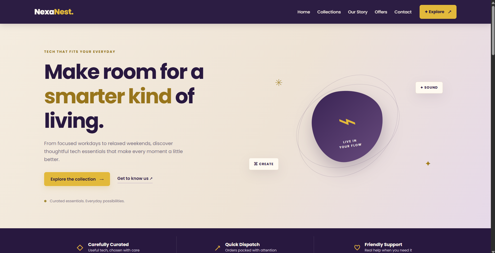
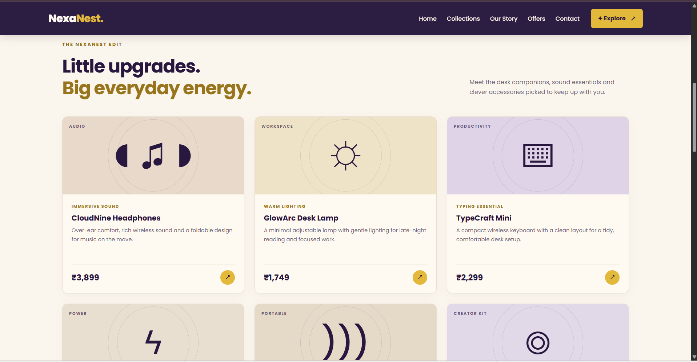
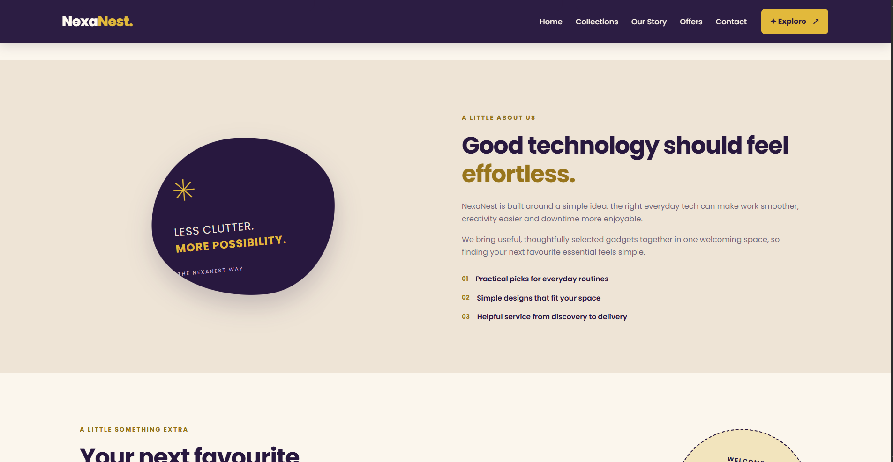
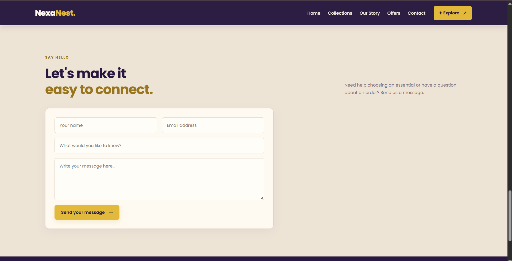

# Ex02 Commercial Website
## Date: 02-11-2026

## AIM
To create a commercial website using CSS Flexbox.

## ALGORITHM
### STEP 1
Create an HTML file (index.html)

### STEP 2
Create a CSS file (style.css)

### STEP 3
Include a navigation bar with links to different sections.

### STEP 4
Add structured sections for Homepage, Products / Services, About Us, Contact Details and User Account.

### STEP 5
Include social media links at the footer with copyright information.

### STEP 6
Define global styles for fonts, colors, and layout.

### STEP 7
Style the header, navigation bar, and sections.

### STEP 8
Use Flexbox for layout design.

### STEP 9
Add hover effects and transitions for interactivity.

### STEP 10
Add Images and Media.

### STEP 11
Use optimized images for a professional look.

### STEP 12
Open the HTML file in a browser to check layout and functionality.

### STEP 13
Fix styling issues and refine content placement.

### STEP 14
Deploy the website.

### STEP 15
Upload to GitHub Pages for free hosting.

## PROGRAM

index.html:

```
<!DOCTYPE html>
<html lang="en">
<head>
  <meta charset="UTF-8">
  <meta name="viewport" content="width=device-width, initial-scale=1.0">
  <meta name="description" content="NexaNest — thoughtfully selected technology for your everyday life.">
  <title>NexaNest | Everyday Tech, Better Living</title>
  <link rel="icon" href="data:,">
  <link rel="preconnect" href="https://fonts.googleapis.com">
  <link rel="preconnect" href="https://fonts.gstatic.com" crossorigin>
  <link href="https://fonts.googleapis.com/css2?family=Poppins:wght@400;500;600;700;800&display=swap" rel="stylesheet">
  <link rel="stylesheet" href="style.css">
</head>
<body>

  <!-- Header / Navigation -->
  <header class="header">
    <a href="#home" class="logo">Nexa<span>Nest.</span></a>
    <nav class="nav" aria-label="Main navigation">
      <ul class="nav-links">
        <li><a href="#home">Home</a></li>
        <li><a href="#collections">Collections</a></li>
        <li><a href="#story">Our Story</a></li>
        <li><a href="#offers">Offers</a></li>
        <li><a href="#contact">Contact</a></li>
      </ul>
      <a href="#collections" class="cart-btn">✦ Explore <span>↗</span></a>
    </nav>
  </header>

  <main>
    <!-- Hero -->
    <section id="home" class="hero">
      <div class="hero-text">
        <span class="eyebrow">TECH THAT FITS YOUR EVERYDAY</span>
        <h1>Make room for a <span>smarter kind</span> of living.</h1>
        <p>From focused workdays to relaxed weekends, discover thoughtful tech essentials that make every moment a little better.</p>
        <div class="hero-actions">
          <a href="#collections" class="btn btn-primary">Explore the collection <span>→</span></a>
          <a href="#story" class="text-link">Get to know us ↗</a>
        </div>
        <div class="hero-note">
          <span class="note-dot"></span>
          Curated essentials. Everyday possibilities.
        </div>
      </div>

      <div class="hero-art" aria-label="Illustration of headphones and smart technology">
        <div class="art-orbit orbit-one"></div>
        <div class="art-orbit orbit-two"></div>
        <div class="art-disc">
          <span>⌁</span>
          <small>LIVE IN<br>YOUR FLOW</small>
        </div>
        <div class="art-chip chip-top">✦ SOUND</div>
        <div class="art-chip chip-bottom">⌘ CREATE</div>
        <div class="art-spark spark-one">✳</div>
        <div class="art-spark spark-two">✦</div>
      </div>
    </section>

    <!-- Benefits -->
    <section class="benefits" aria-label="Shopping benefits">
      <div class="benefit">
        <span class="benefit-icon">◇</span>
        <div>
          <h3>Carefully Curated</h3>
          <p>Useful tech, chosen with care</p>
        </div>
      </div>
      <div class="benefit">
        <span class="benefit-icon">↗</span>
        <div>
          <h3>Quick Dispatch</h3>
          <p>Orders packed with attention</p>
        </div>
      </div>
      <div class="benefit">
        <span class="benefit-icon">♡</span>
        <div>
          <h3>Friendly Support</h3>
          <p>Real help when you need it</p>
        </div>
      </div>
    </section>

    <!-- Collections -->
    <section id="collections" class="collections section-wrap">
      <div class="section-heading">
        <div>
          <span class="eyebrow">THE NEXANEST EDIT</span>
          <h2>Little upgrades.<br><span>Big everyday energy.</span></h2>
        </div>
        <p>Meet the desk companions, sound essentials and clever accessories picked to keep up with you.</p>
      </div>

      <div class="product-grid">

        <article class="product-card">
          <div class="product-art art-headphones">
            <span class="product-symbol">◖♫◗</span>
            <span class="product-label">AUDIO</span>
          </div>
          <div class="product-info">
            <div class="product-type">IMMERSIVE SOUND</div>
            <h3>CloudNine Headphones</h3>
            <p>Over-ear comfort, rich wireless sound and a foldable design for music on the move.</p>
            <div class="product-bottom">
              <span class="price">₹3,899</span>
              <a href="#contact" class="product-link" aria-label="Enquire about CloudNine Headphones">↗</a>
            </div>
          </div>
        </article>

        <article class="product-card">
          <div class="product-art art-lamp">
            <span class="product-symbol">☼</span>
            <span class="product-label">WORKSPACE</span>
          </div>
          <div class="product-info">
            <div class="product-type">WARM LIGHTING</div>
            <h3>GlowArc Desk Lamp</h3>
            <p>A minimal adjustable lamp with gentle lighting for late-night reading and focused work.</p>
            <div class="product-bottom">
              <span class="price">₹1,749</span>
              <a href="#contact" class="product-link" aria-label="Enquire about GlowArc Desk Lamp">↗</a>
            </div>
          </div>
        </article>

        <article class="product-card">
          <div class="product-art art-keyboard">
            <span class="product-symbol">⌨</span>
            <span class="product-label">PRODUCTIVITY</span>
          </div>
          <div class="product-info">
            <div class="product-type">TYPING ESSENTIAL</div>
            <h3>TypeCraft Mini</h3>
            <p>A compact wireless keyboard with a clean layout for a tidy, comfortable desk setup.</p>
            <div class="product-bottom">
              <span class="price">₹2,299</span>
              <a href="#contact" class="product-link" aria-label="Enquire about TypeCraft Mini">↗</a>
            </div>
          </div>
        </article>

        <article class="product-card">
          <div class="product-art art-charger">
            <span class="product-symbol">ϟ</span>
            <span class="product-label">POWER</span>
          </div>
          <div class="product-info">
            <div class="product-type">ALL-IN-ONE CHARGING</div>
            <h3>SnapDock Trio</h3>
            <p>A neat multi-device charging stand that helps keep your everyday essentials together.</p>
            <div class="product-bottom">
              <span class="price">₹2,699</span>
              <a href="#contact" class="product-link" aria-label="Enquire about SnapDock Trio">↗</a>
            </div>
          </div>
        </article>

        <article class="product-card">
          <div class="product-art art-speaker">
            <span class="product-symbol">)))</span>
            <span class="product-label">PORTABLE</span>
          </div>
          <div class="product-info">
            <div class="product-type">MUSIC ANYWHERE</div>
            <h3>BeatPebble Speaker</h3>
            <p>A pocket-friendly Bluetooth speaker with punchy sound for your room or a day out.</p>
            <div class="product-bottom">
              <span class="price">₹1,499</span>
              <a href="#contact" class="product-link" aria-label="Enquire about BeatPebble Speaker">↗</a>
            </div>
          </div>
        </article>

        <article class="product-card">
          <div class="product-art art-webcam">
            <span class="product-symbol">◎</span>
            <span class="product-label">CREATOR KIT</span>
          </div>
          <div class="product-info">
            <div class="product-type">CLEAR CONNECTIONS</div>
            <h3>FocusFrame Webcam</h3>
            <p>A simple HD webcam with a flexible clip for online classes, calls and content creation.</p>
            <div class="product-bottom">
              <span class="price">₹2,099</span>
              <a href="#contact" class="product-link" aria-label="Enquire about FocusFrame Webcam">↗</a>
            </div>
          </div>
        </article>

      </div>
    </section>

    <!-- Our Story -->
    <section id="story" class="story">
      <div class="story-visual">
        <div class="story-card">
          <span class="story-star">✳</span>
          <p>LESS CLUTTER.<br><strong>MORE POSSIBILITY.</strong></p>
          <span class="story-caption">THE NEXANEST WAY</span>
        </div>
      </div>

      <div class="story-copy">
        <span class="eyebrow">A LITTLE ABOUT US</span>
        <h2>Good technology should feel <span>effortless.</span></h2>
        <p>NexaNest is built around a simple idea: the right everyday tech can make work smoother, creativity easier and downtime more enjoyable.</p>
        <p>We bring useful, thoughtfully selected gadgets together in one welcoming space, so finding your next favourite essential feels simple.</p>
        <ul class="story-points">
          <li><span>01</span> Practical picks for everyday routines</li>
          <li><span>02</span> Simple designs that fit your space</li>
          <li><span>03</span> Helpful service from discovery to delivery</li>
        </ul>
      </div>
    </section>

    <!-- Offers -->
    <section id="offers" class="offers section-wrap">
      <div class="offer-copy">
        <span class="eyebrow">A LITTLE SOMETHING EXTRA</span>
        <h2>Your next favourite<br>upgrade is waiting.</h2>
        <p>Enjoy a welcome saving on your first NexaNest order. Make space for something useful.</p>
        <a href="#collections" class="btn btn-dark">Find your favourite ↗</a>
      </div>

      <div class="offer-stamp">
        <span>WELCOME<br>OFFER</span>
        <strong>15<small>% OFF</small></strong>
        <span class="stamp-code">USE CODE: NEST15</span>
      </div>
    </section>

    <!-- Contact -->
    <section id="contact" class="contact section-wrap">
      <div class="section-heading contact-heading">
        <div>
          <span class="eyebrow">SAY HELLO</span>
          <h2>Let's make it<br><span>easy to connect.</span></h2>
        </div>
        <p>Need help choosing an essential or have a question about an order? Send us a message.</p>
      </div>

      <form class="contact-form" action="#" onsubmit="return false;">
        <div class="form-row">
          <input type="text" placeholder="Your name" aria-label="Your name" required>
          <input type="email" placeholder="Email address" aria-label="Email address" required>
        </div>
        <input type="text" placeholder="What would you like to know?" aria-label="Subject">
        <textarea rows="5" placeholder="Write your message here..." aria-label="Your message" required></textarea>
        <button type="submit" class="btn btn-primary">Send your message <span>→</span></button>
      </form>
    </section>
  </main>

  <!-- Footer -->
  <footer class="footer">
    <div class="footer-main">
      <div class="footer-brand">
        <a href="#home" class="logo">Nexa<span>Nest.</span></a>
        <p>Thoughtful technology for work, play and all the little moments in between.</p>
      </div>

      <div class="footer-col">
        <h4>Explore</h4>
        <ul>
          <li><a href="#home">Home</a></li>
          <li><a href="#collections">Collections</a></li>
          <li><a href="#story">Our Story</a></li>
          <li><a href="#offers">Offers</a></li>
        </ul>
      </div>

      <div class="footer-col">
        <h4>Get in touch</h4>
        <ul>
          <li>Chennai, Tamil Nadu</li>
          <li>+91 00000 00000</li>
          <li>hello@nexanest.example</li>
        </ul>
      </div>
    </div>

    <div class="footer-bottom">
      <p>Designed by Nandhini M | Register No: 212224040211 | &copy; 2026</p>
      <a href="#home">Back to top ↑</a>
    </div>
  </footer>

</body>
</html>
```

style.css:

```
/* NexaNest — Dark Purple, Mustard Yellow & Warm Beige */

:root {
  --purple: #28183f;
  --purple-soft: #4b3563;
  --yellow: #e2b93b;
  --yellow-dark: #c99b19;
  --beige: #f4ecdf;
  --beige-deep: #e9ddca;
  --cream: #fffaf1;
  --ink: #34283e;
  --muted: #716779;
  --line: #e7dccd;
  --shadow: 0 14px 36px rgba(40, 24, 63, .09);
}

/* ===== Base ===== */

* {
  margin: 0;
  padding: 0;
  box-sizing: border-box;
}

html {
  scroll-behavior: smooth;
  scroll-padding-top: 90px;
}

body {
  font-family: "Poppins", sans-serif;
  color: var(--muted);
  background: var(--cream);
  line-height: 1.7;
}

a {
  color: inherit;
  text-decoration: none;
}

ul {
  list-style: none;
}

h1, h2, h3, h4 {
  color: var(--purple);
  line-height: 1.2;
}

/* ===== Header / Navigation ===== */

.header {
  position: sticky;
  top: 0;
  z-index: 20;
  display: flex;
  justify-content: space-between;
  align-items: center;
  gap: 25px;
  padding: 17px 7%;
  background: rgba(40,24,63,.98);
  box-shadow: 0 5px 20px rgba(25,13,39,.15);
}

.logo {
  color: var(--cream);
  font-size: 1.65rem;
  font-weight: 800;
  letter-spacing: -.8px;
}

.logo span {
  color: var(--yellow);
}

.nav {
  display: flex;
  align-items: center;
  gap: 28px;
}

.nav-links {
  display: flex;
  align-items: center;
  gap: 25px;
}

.nav-links a {
  color: #f8f0e5;
  font-size: .9rem;
  font-weight: 500;
  transition: color .2s;
}

.nav-links a:hover {
  color: var(--yellow);
}

.cart-btn {
  display: inline-flex;
  align-items: center;
  gap: 12px;
  padding: 9px 17px;
  border-radius: 7px;
  background: var(--yellow);
  color: var(--purple);
  font-size: .88rem;
  font-weight: 700;
}

.cart-btn span {
  font-size: 1.1rem;
}

/* ===== Hero Section ===== */

.hero {
  min-height: 570px;
  display: flex;
  align-items: center;
  justify-content: space-between;
  gap: 55px;
  padding: 82px 9%;
  background: linear-gradient(
    115deg,
    #f4ecdf 0%,
    #eee3d5 55%,
    #e6d9e9 100%
  );
  overflow: hidden;
}

.hero-text {
  flex: 1.1;
  max-width: 650px;
}

.eyebrow {
  display: inline-block;
  margin-bottom: 16px;
  color: #927016;
  font-size: .73rem;
  font-weight: 700;
  letter-spacing: 2px;
}

.hero h1 {
  max-width: 650px;
  margin-bottom: 22px;
  font-size: clamp(2.8rem, 5vw, 4.4rem);
  font-weight: 700;
  letter-spacing: -2.5px;
}

.hero h1 span {
  color: #98751c;
}

.hero-text > p {
  max-width: 530px;
  font-size: 1.02rem;
}

.hero-actions {
  display: flex;
  align-items: center;
  flex-wrap: wrap;
  gap: 25px;
  margin-top: 30px;
}

.btn {
  display: inline-flex;
  justify-content: center;
  align-items: center;
  gap: 13px;
  padding: 13px 22px;
  border: 0;
  border-radius: 7px;
  font: 600 .9rem "Poppins", sans-serif;
  cursor: pointer;
  transition: transform .2s, background .2s, box-shadow .2s;
}

.btn:hover {
  transform: translateY(-3px);
}

.btn-primary {
  background: var(--yellow);
  color: var(--purple);
  box-shadow: 0 7px 18px rgba(201,155,25,.18);
}

.btn-primary:hover {
  background: #edca58;
}

.text-link {
  color: var(--purple);
  font-size: .9rem;
  font-weight: 600;
  border-bottom: 1px solid #b9a6c3;
  padding-bottom: 3px;
}

.hero-note {
  margin-top: 42px;
  color: #786d7e;
  font-size: .78rem;
}

.note-dot {
  display: inline-block;
  width: 8px;
  height: 8px;
  margin-right: 8px;
  border-radius: 50%;
  background: #a38a37;
}

/* ===== Hero Illustration ===== */

.hero-art {
  position: relative;
  flex: .9;
  min-height: 390px;
  display: grid;
  place-items: center;
}

.art-orbit {
  position: absolute;
  border: 1px solid rgba(75,53,99,.22);
  border-radius: 50%;
  transform: rotate(-24deg);
}

.orbit-one {
  width: 370px;
  height: 270px;
}

.orbit-two {
  width: 300px;
  height: 390px;
  transform: rotate(42deg);
}

.art-disc {
  position: relative;
  z-index: 1;
  display: flex;
  flex-direction: column;
  justify-content: center;
  align-items: center;
  width: 245px;
  height: 245px;
  border-radius: 43% 57% 58% 42% / 45% 40% 60% 55%;
  background: linear-gradient(145deg, #3a2454, #684b7d);
  color: var(--yellow);
  box-shadow: 0 25px 55px rgba(40,24,63,.25);
  transform: rotate(-8deg);
}

.art-disc > span {
  font-size: 7rem;
  line-height: 1;
}

.art-disc small {
  margin-top: 12px;
  color: var(--cream);
  font-size: .65rem;
  line-height: 1.5;
  font-weight: 600;
  letter-spacing: 2px;
  text-align: center;
}

.art-chip {
  position: absolute;
  z-index: 2;
  padding: 10px 16px;
  border: 1px solid #e8ddcd;
  border-radius: 6px;
  background: var(--cream);
  color: var(--purple);
  box-shadow: var(--shadow);
  font-size: .72rem;
  font-weight: 700;
  letter-spacing: 1px;
}

.chip-top {
  top: 42px;
  right: 2%;
}

.chip-bottom {
  bottom: 43px;
  left: 0;
}

.art-spark {
  position: absolute;
  color: #a27c1a;
  font-size: 2rem;
}

.spark-one {
  top: 18px;
  left: 13%;
}

.spark-two {
  right: 8%;
  bottom: 45px;
  font-size: 1.5rem;
}

/* ===== Benefits Section ===== */

.benefits {
  display: grid;
  grid-template-columns: repeat(3, 1fr);
  gap: 1px;
  padding: 28px 8%;
  background: var(--purple);
}

.benefit {
  display: flex;
  align-items: center;
  justify-content: center;
  gap: 15px;
  padding: 12px 20px;
  border-right: 1px solid rgba(255,250,241,.15);
}

.benefit:last-child {
  border-right: 0;
}

.benefit-icon {
  color: var(--yellow);
  font-size: 2rem;
}

.benefit h3 {
  color: var(--cream);
  font-size: .95rem;
}

.benefit p {
  color: #cfc2d7;
  font-size: .76rem;
}

/* ===== Common Section Layout ===== */

.section-wrap {
  padding: 92px 9%;
}

.collections {
  background: #fbf6ed;
}

.section-heading {
  display: flex;
  justify-content: space-between;
  align-items: end;
  gap: 40px;
  margin-bottom: 42px;
}

.section-heading h2,
.story-copy h2,
.offer-copy h2 {
  font-size: clamp(2rem, 3.5vw, 2.8rem);
  letter-spacing: -1.3px;
}

.section-heading h2 span,
.story-copy h2 span {
  color: #98751c;
}

.section-heading > p {
  max-width: 390px;
  padding-bottom: 5px;
  font-size: .9rem;
}

/* ===== Products Section ===== */

.product-grid {
  display: grid;
  grid-template-columns: repeat(3, minmax(0,1fr));
  gap: 25px;
}

.product-card {
  overflow: hidden;
  border: 1px solid var(--line);
  border-radius: 13px;
  background: var(--cream);
  box-shadow: 0 7px 22px rgba(40,24,63,.045);
  transition: transform .25s, box-shadow .25s;
}

.product-card:hover {
  transform: translateY(-7px);
  box-shadow: var(--shadow);
}

.product-art {
  position: relative;
  height: 190px;
  display: grid;
  place-items: center;
  overflow: hidden;
}

.product-art::before,
.product-art::after {
  content: "";
  position: absolute;
  border: 1px solid rgba(40,24,63,.12);
  border-radius: 50%;
}

.product-art::before {
  width: 175px;
  height: 175px;
}

.product-art::after {
  width: 220px;
  height: 220px;
}

.product-symbol {
  position: relative;
  z-index: 1;
  color: var(--purple);
  font-size: 5rem;
  font-weight: 500;
}

.product-label {
  position: absolute;
  top: 15px;
  left: 16px;
  z-index: 2;
  color: rgba(40,24,63,.65);
  font-size: .62rem;
  font-weight: 700;
  letter-spacing: 1.5px;
}

/* Individual Product Backgrounds */

.art-headphones {
  background: #e8d9cb;
}

.art-lamp {
  background: #efe3c7;
}

.art-keyboard {
  background: #ded3e7;
}

.art-charger {
  background: #e8dfd0;
}

.art-speaker {
  background: #e5d9c8;
}

.art-webcam {
  background: #e1d9e8;
}

/* Product Details */

.product-info {
  padding: 22px 22px 20px;
}

.product-type {
  margin-bottom: 8px;
  color: #9a781e;
  font-size: .64rem;
  font-weight: 700;
  letter-spacing: 1.4px;
}

.product-info h3 {
  margin-bottom: 9px;
  font-size: 1.12rem;
}

.product-info p {
  min-height: 76px;
  font-size: .82rem;
  line-height: 1.65;
}

.product-bottom {
  display: flex;
  justify-content: space-between;
  align-items: center;
  margin-top: 17px;
  padding-top: 14px;
  border-top: 1px solid var(--line);
}

.price {
  color: var(--purple);
  font-size: 1.25rem;
  font-weight: 700;
}

.product-link {
  display: grid;
  place-items: center;
  width: 36px;
  height: 36px;
  border-radius: 50%;
  background: var(--yellow);
  color: var(--purple);
  font-size: 1.2rem;
  transition: transform .2s;
}

.product-link:hover {
  transform: rotate(45deg);
}

/* ===== Our Story Section ===== */

.story {
  display: grid;
  grid-template-columns: 1fr 1.1fr;
  align-items: center;
  gap: 9%;
  padding: 95px 10%;
  background: #eee4d6;
}

.story-visual {
  display: grid;
  place-items: center;
  min-height: 360px;
}

.story-card {
  position: relative;
  display: flex;
  flex-direction: column;
  justify-content: center;
  width: min(100%, 350px);
  min-height: 300px;
  padding: 42px;
  border-radius: 48% 52% 42% 58% / 55% 42% 58% 45%;
  background: var(--purple);
  color: var(--cream);
  box-shadow: 0 22px 45px rgba(40,24,63,.2);
  transform: rotate(-5deg);
}

.story-star {
  color: var(--yellow);
  font-size: 3.5rem;
}

.story-card p {
  margin-top: 15px;
  color: #eee3d6;
  font-size: 1.3rem;
  line-height: 1.5;
  letter-spacing: 1px;
}

.story-card strong {
  color: var(--yellow);
}

.story-caption {
  margin-top: 25px;
  color: #cdbed7;
  font-size: .62rem;
  letter-spacing: 2px;
}

.story-copy h2 {
  margin-bottom: 22px;
}

.story-copy > p {
  margin-bottom: 14px;
  font-size: .9rem;
}

.story-points {
  display: grid;
  gap: 13px;
  margin-top: 27px;
}

.story-points li {
  display: flex;
  align-items: center;
  gap: 14px;
  color: var(--purple);
  font-size: .85rem;
  font-weight: 600;
}

.story-points span {
  color: #a17b1d;
  font-size: .75rem;
  font-weight: 700;
}

/* ===== Offers Section ===== */

.offers {
  display: flex;
  justify-content: space-between;
  align-items: center;
  gap: 45px;
  background: #fbf6ed;
}

.offer-copy {
  max-width: 550px;
}

.offer-copy h2 {
  margin-bottom: 16px;
}

.offer-copy p {
  max-width: 440px;
  margin-bottom: 25px;
  font-size: .9rem;
}

.btn-dark {
  background: var(--purple);
  color: var(--cream);
}

.btn-dark:hover {
  background: var(--purple-soft);
}

.offer-stamp {
  display: flex;
  flex-direction: column;
  align-items: center;
  justify-content: center;
  width: 260px;
  height: 260px;
  flex-shrink: 0;
  border: 2px dashed var(--purple);
  border-radius: 50%;
  background: #f2e4bd;
  color: var(--purple);
  transform: rotate(7deg);
}

.offer-stamp > span:first-child {
  font-size: .7rem;
  font-weight: 700;
  letter-spacing: 2px;
  text-align: center;
}

.offer-stamp strong {
  margin: 5px 0;
  font-size: 4.6rem;
  line-height: 1;
}

.offer-stamp strong small {
  display: block;
  font-size: 1rem;
  text-align: center;
  letter-spacing: 2px;
}

.stamp-code {
  font-size: .68rem;
  font-weight: 700;
  letter-spacing: 1.5px;
}

/* ===== Contact Section ===== */

.contact {
  background: #eee4d6;
}

.contact-heading {
  margin-bottom: 35px;
}

.contact-form {
  display: flex;
  flex-direction: column;
  gap: 16px;
  max-width: 760px;
  padding: 30px;
  border: 1px solid #e1d4c3;
  border-radius: 13px;
  background: var(--cream);
  box-shadow: 0 10px 28px rgba(40,24,63,.06);
}

.form-row {
  display: flex;
  gap: 16px;
}

.form-row input {
  flex: 1;
}

.contact-form input,
.contact-form textarea {
  width: 100%;
  padding: 14px 16px;
  border: 1px solid #dfd3c4;
  border-radius: 7px;
  outline: none;
  background: #fffdf8;
  color: var(--purple);
  font: .88rem "Poppins", sans-serif;
  transition: border .2s, box-shadow .2s;
}

.contact-form input:focus,
.contact-form textarea:focus {
  border-color: #b18a24;
  box-shadow: 0 0 0 3px rgba(226,185,59,.18);
}

.contact-form textarea {
  resize: vertical;
}

.contact-form .btn {
  align-self: flex-start;
}

/* ===== Footer ===== */

.footer {
  padding: 0 9%;
  background: var(--purple);
  color: #d4c8dc;
}

.footer-main {
  display: grid;
  grid-template-columns: 2fr 1fr 1.2fr;
  gap: 60px;
  padding: 60px 0 45px;
}

.footer-brand p {
  max-width: 300px;
  margin-top: 15px;
  font-size: .83rem;
}

.footer-col h4 {
  margin-bottom: 16px;
  color: var(--yellow);
  font-size: .95rem;
}

.footer-col ul {
  display: grid;
  gap: 9px;
  font-size: .82rem;
}

.footer-col a:hover,
.footer-bottom a:hover {
  color: var(--yellow);
}

.footer-bottom {
  display: flex;
  justify-content: space-between;
  gap: 20px;
  padding: 19px 0;
  border-top: 1px solid rgba(255,250,241,.14);
  color: #eee5f1;
  font-size: .76rem;
}

/* ===== Responsive: Tablets ===== */

@media (max-width: 950px) {
  .header {
    flex-direction: column;
  }

  .nav {
    flex-wrap: wrap;
    justify-content: center;
  }

  .hero {
    padding: 65px 7%;
  }

  .hero h1 {
    font-size: 3.1rem;
  }

  .product-grid {
    grid-template-columns: repeat(2, minmax(0,1fr));
  }

  .story {
    padding: 75px 7%;
    gap: 5%;
  }
}

/* ===== Responsive: Mobile ===== */

@media (max-width: 700px) {
  .nav {
    gap: 16px;
  }

  .nav-links {
    justify-content: center;
    flex-wrap: wrap;
    gap: 12px 18px;
  }

  .nav-links a {
    font-size: .82rem;
  }

  .hero {
    flex-direction: column;
    text-align: center;
    padding: 58px 7% 35px;
  }

  .hero-text {
    display: flex;
    flex-direction: column;
    align-items: center;
  }

  .hero h1 {
    font-size: 2.7rem;
    letter-spacing: -1.5px;
  }

  .hero-actions {
    justify-content: center;
  }

  .hero-note {
    margin-top: 25px;
  }

  .hero-art {
    width: 100%;
    min-height: 330px;
  }

  .art-disc {
    width: 205px;
    height: 205px;
  }

  .art-disc > span {
    font-size: 5.5rem;
  }

  .orbit-one {
    width: 290px;
    height: 220px;
  }

  .orbit-two {
    width: 240px;
    height: 310px;
  }

  .benefits {
    grid-template-columns: 1fr;
    padding: 22px 7%;
  }

  .benefit {
    justify-content: flex-start;
    border-right: 0;
    border-bottom: 1px solid rgba(255,250,241,.15);
  }

  .benefit:last-child {
    border-bottom: 0;
  }

  .section-wrap {
    padding: 65px 7%;
  }

  .section-heading {
    flex-direction: column;
    align-items: flex-start;
    gap: 15px;
  }

  .story {
    grid-template-columns: 1fr;
    padding: 65px 7%;
  }

  .story-visual {
    min-height: 310px;
  }

  .offers {
    flex-direction: column;
    align-items: flex-start;
  }

  .offer-stamp {
    align-self: center;
  }

  .footer-main {
    grid-template-columns: 1fr 1fr;
    gap: 35px;
  }

  .footer-brand {
    grid-column: 1 / -1;
  }
}

/* ===== Responsive: Small Phones ===== */

@media (max-width: 480px) {
  .header {
    padding: 15px 5%;
  }

  .nav {
    flex-direction: column;
  }

  .nav-links {
    gap: 10px 14px;
  }

  .hero h1 {
    font-size: 2.25rem;
  }

  .hero-actions {
    flex-direction: column;
    gap: 16px;
  }

  .product-grid {
    grid-template-columns: 1fr;
  }

  .product-info p {
    min-height: auto;
  }

  .form-row {
    flex-direction: column;
  }

  .contact-form {
    padding: 20px;
  }

  .contact-form .btn {
    width: 100%;
  }

  .footer {
    padding: 0 7%;
  }

  .footer-main {
    grid-template-columns: 1fr;
  }

  .footer-brand {
    grid-column: auto;
  }

  .footer-bottom {
    flex-direction: column;
    text-align: center;
  }
}
```

## OUTPUT









## RESULT
The program for creating commercial website using CSS Flexbox is executed successfully.